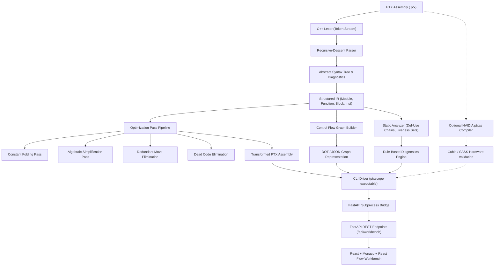

# PTXScope Architecture & System Design

PTXScope is structured as a modular, three-tier compiler analysis platform consisting of a standalone C++17 compiler engine, a lightweight Python FastAPI backend service, and a modern React/TypeScript/Monaco workbench frontend.

---

## 1. Compiler Engine Tier (`engine/`)

The core engine is implemented in standard C++17 with strict compiler warnings enabled (`-Wall -Wextra -pedantic` / `/W4`). It operates independently without requiring an active graphical desktop, backend server, or NVIDIA GPU.

### 1.1 Lexer (`lexer.hpp`, `lexer.cpp`)
- Performs single-pass tokenization with line and column source location tracking (`SourceLocation`, `SourceSpan`).
- Identifies directive tokens (`.version`, `.target`, `.entry`, `.param`, `.reg`), instruction opcodes, predicate indicators (`@`, `!`), typed registers (`%r1`, `%rd0`, `%p0`), special hardware registers (`%tid.x`, `%ctaid.x`), numeric literals (decimal, hexadecimal, float literals), and comments (`//`, `/* */`).
- Reports precise syntax errors when encountering invalid characters without terminating prematurely.

### 1.2 Recursive-Descent Parser (`parser.hpp`, `parser.cpp`)
- Constructs a structured AST and in-memory IR from the token stream.
- Validates parameter declarations, register allocations, label placements, and predicated instructions.
- Implements error recovery: upon encountering a malformed statement, logs a structured diagnostic and synchronizes to the next delimiter (`;` or `}`) to surface subsequent syntax issues.

### 1.3 Intermediate Representation (`ir.hpp`, `ir.cpp`)
- Represents PTX modules, functions, basic blocks, instructions, and typed operands as explicit C++ structures with clean ownership.
- Types: `.u8`, `.u16`, `.u32`, `.u64`, `.s8`, `.s16`, `.s32`, `.s64`, `.b8`, `.b16`, `.b32`, `.b64`, `.f16`, `.f32`, `.f64`, `.pred`.
- Instructions maintain opcode, predicate register, condition flag, state space (`.global`, `.param`, `.shared`), modifiers, source locations, and operands.
- Methods provide query primitives: `is_terminator()`, `is_branch()`, `branch_target()`, `has_side_effects()`, `get_def_reg()`, and `get_use_regs()`.

### 1.4 Control-Flow Graph (`cfg.hpp`, `cfg.cpp`)
- Analyzes branch instructions (`bra`), conditional predicates, and fallthrough paths to construct directed control flow graphs.
- Discovers predecessors and successors for each basic block.
- Implements BFS/DFS reachability analysis from function entry blocks to identify dead or orphaned basic blocks.
- Serializes graphs into Graphviz DOT syntax and JSON payloads.

### 1.5 Static & Liveness Analysis (`analysis.hpp`, `analysis.cpp`)
- **Def-Use Chains**: Computes per-register definition and usage sites across all blocks.
- **Liveness Analysis**: Formulates backward data-flow equations over basic blocks:
  $$LiveOut[B] = \bigcup_{S \in Succ[B]} LiveIn[S]$$
  $$LiveIn[B] = Gen[B] \cup (LiveOut[B] \setminus Kill[B])$$
  Computes fixed-point convergence iteratively.
- **Diagnostic Engine**: Rule-based checks for unused registers, unreachable code, self-moves, duplicate calculations, long dependency chains, and invalid branch targets.

### 1.6 Optimization Pipeline (`optimizer.hpp`, `passes/`)
- Coordinated by `PassManager`.
- Runs four conservative passes:
  1. `ConstantFoldingPass`: Type-aware compile-time arithmetic.
  2. `AlgebraicSimplificationPass`: Identity rules ($x+0 \to x$, $x \times 1 \to x$, etc.).
  3. `RedundantMovePass`: Self-move and duplicate copy elimination.
  4. `DeadCodeEliminationPass`: Prunes unreachable blocks and unused register computations while strictly preserving side effects (`st`, `bar.sync`, `ret`).

---

## 2. Backend Service Tier (`backend/`)

Built with Python 3.12, FastAPI, and Pydantic.

- **Process Isolation**: The backend invokes the compiled C++ executable (`ptxscope`) via `subprocess.run` with array-separated arguments. No shell string concatenation is permitted.
- **Security & Limits**:
  - Request payload size is capped at 512 KB (`max_length=524288`).
  - Execution timeout is enforced at 10 seconds.
  - Temporary files are created in isolated temporary directories and cleaned up in `finally` blocks.
- **REST Endpoints**:
  - `GET /api/health`
  - `GET /api/capabilities`
  - `POST /api/workbench`
  - `POST /api/parse`
  - `POST /api/analyze`
  - `POST /api/optimize`
  - `POST /api/cfg`
  - `POST /api/validate`
  - `GET /api/samples`
  - `GET /api/samples/{name}`

---

## 3. Frontend Tier (`frontend/`)

Built with React 18, TypeScript, Vite, and Tailwind CSS.

- **Monaco Editor Integration**: Custom Monarch language definition specifically designed for PTX syntax, tokenizing directives, instructions, types, registers, and predicates. Real-time diagnostic markers decorate code lines.
- **Control Flow Graph View**: Renders basic blocks with instruction inspection, entry markers, unreachable warnings, and color-coded branch edges.
- **Optimization Diff View**: Side-by-side comparison of original and transformed assembly, with an optimization log detailing pass actions and skipped safety rules.
- **Register & Liveness Panel**: Full register census table (defs, uses, active status) and Live-In/Live-Out sets per block.
- **Compiler Validation**: Invokes and reports genuine `ptxas` compiler diagnostics, exit codes, and output without mock data.

---

## 4. PTX Virtual ISA vs SASS Machine Code

PTX is a pseudo-assembly virtual instruction set designed to provide forward-compatibility across GPU generations. The GPU hardware itself cannot directly execute PTX.

Instead, the NVIDIA compiler (`ptxas` or driver JIT) translates PTX into **SASS** (Streaming Assembler), which encodes the actual microarchitectural machine instructions tailored to specific Streaming Multiprocessors (SMs).

Static analysis on PTX provides crucial compiler insights—such as register live ranges, dead computation elimination, and loop structures. However, physical GPU performance is also governed by runtime factors such as warp scheduling, memory bank conflicts, cache residency, and occupancy. PTXScope explicitly separates static compiler heuristics from hardware profiling.
